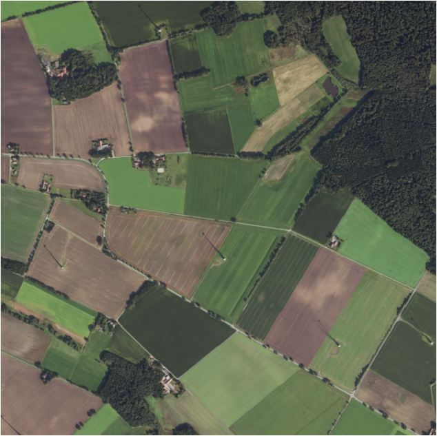
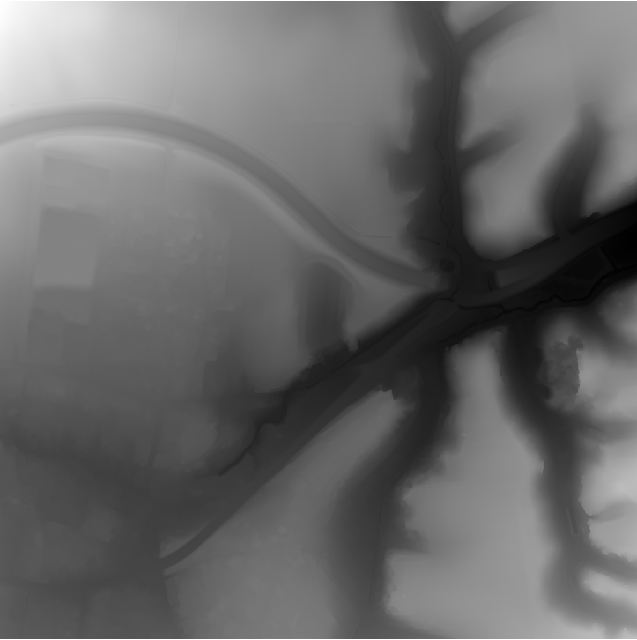

# GeoTIFF Image Compression Benchmark

*A comprehensive test and comparison of compression formats and types for geospatial raster data.*

For a rendered version with detailed results 
[](https://wiesehahn.github.io/posts/image_compression/)

## Overview

Geospatial raster data can quickly balloon to enormous sizes, creating challenges for storage and distribution. With dozens of compression algorithms available—each with different trade-offs between file size, speed, and data fidelity—choosing the right approach isn't straightforward.

This benchmark tests various compression formats available for GeoTIFF images via GDAL on two common data types:
- **RGB orthoimagery** (aerial photos with 4 spectral bands)
- **Digital elevation models** (terrain height data)

We compare traditional methods with newer approaches (WEBP, LERC, RGB-encoded elevation) to help you select appropriate compression for your use case.

## Test Data



### Orthophoto Imagery

**Source:** Five ortho-image tiles from Lower Saxony, Germany (LGLN)
- **Coverage:** 2×2 km per tile
- **Resolution:** 20 cm
- **Bands:** 4 (Red, Green, Blue, Infrared)
- **Format:** Uncompressed Cloud Optimized GeoTIFF
- **Data type:** Byte (8-bit unsigned integer)
- **Size:** 10,000×10,000 pixels, ~539 MB per tile

### Digital Elevation Models

**Source:** Five terrain model tiles from Lower Saxony, Germany (LGLN)
- **Coverage:** 1×1 km per tile
- **Resolution:** 1 m
- **Bands:** 1 (elevation)
- **Format:** Cloud Optimized GeoTIFF (LZW compressed)
- **Data type:** Float32 (32-bit floating point)
- **Size:** 1,000×1,000 pixels

## Compression Methods

### Lossless Compression
Preserves all original data without any changes:
- **LZW** (with/without predictor)
- **DEFLATE** (zlib, levels 1/6/9)
- **ZSTD** (levels 1/9/22)
- **LZMA** (levels 1/9)
- **LERC** (Limited Error Raster Compression)
- **LERC_DEFLATE** & **LERC_ZSTD** (LERC + additional compression)
- **WEBP** (quality 100)

### Lossy Compression
Reduces file size with minor visual changes:
- **WEBP** (quality < 100)
- **Bit reduction** for RGB-encoded elevation data

### RGB Encoding for Elevation Data
Encodes floating-point elevation values into 3 RGB channels (byte format):

**Mapbox Encoding:**
```
height = -10000 + ((R × 256² + G × 256 + B) × 0.1)
```
- Precision: 0.1 m (10 cm)
- Range: -10,000 to +167,4301 m

**Terrarium Encoding:**
```
height = (R × 256 + G + B / 256) - 32,768
```
- Precision: ~0.004 m (4 mm)
- Range: -32,768 to +32,767 m

## Key Findings

### Orthophoto Imagery

**Best Lossless Compression:**
- **WEBP (Quality 100):** 42% of original size
- **ZSTD (Predictor, Level 22):** 56% of original size
- **LERC-based methods:** 61-62% of original size

**Best Lossy Compression:**
- **WEBP (Quality 75):** 16% of original size with minimal visual impact


### Elevation Data (Single-band Float32)

**Best Lossless Compression:**
- **LZMA (Level 9):** 50% of original size
- **ZSTD (Predictor, Level 22):** 63% of original size
- **DEFLATE (Predictor, Level 9):** 64% of original size

### RGB-Encoded Elevation Data

**Best Overall:**
- **WEBP (Quality 100):** ~6% of original Float32 size
  - Mapbox encoding: 0.23 MB (vs 3.96 MB original)
  - Terrarium encoding: 0.85 MB (vs 3.96 MB original)

## Recommendations

### For Orthoimagery

**Storage/Archival (lossless required):**
- Use **WEBP Quality 100** for best compression

**Vizualization (lossy acceptable):**
- Use **WEBP Quality 75-85** for visually lossless results
- Consider **WEBP Quality 100** with **OVERVIEW_QUALITY=75** for multi-resolution datasets

### For Elevation Data

**Maximum Compression (lossless):**
- Convert to RGB encoding (Terrarium or Mapbox)
- Apply **WEBP Quality 100** compression
- Achieves 94% size reduction

**Standard Single-band Storage:**
- Use **ZSTD Predictor Level 9** for good compression and performance
- Alternative: **DEFLATE Predictor Level 6** for broader compatibility

**Web Visualization:**
- Use RGB-encoded tiles with **WEBP compression**

### General Guidelines

1. **Always use some compression** - even fast algorithms (LZW, ZSTD Level 1) provide significant benefits
2. **Match compression to use case:**
   - Scientific analysis: Lossless compression
   - Visualization: Lossy compression acceptable
3. **Test with your data** - results vary by data characteristics (complexity, patterns, noise)

## Limitations

- Lossy compression alters original data - unsuitable for analytical workflows requiring raw values
- RGB encoding requires encoding/decoding steps - not transparent to all software
- Compression performance varies by data characteristics
- Results may differ for other geographic regions or data types

## Technical Details

### Cloud Optimized GeoTIFF (COG)
All compressed files were created as COGs with:
- **Tile size:** 512×512 pixels
- **Overviews:** Multiple pyramid levels

### Benchmark Environment
- **Processor:** 32 threads (GDAL_NUM_THREADS=32)
- **Cache:** 8 GB (GDAL_CACHEMAX=8000)
- **Software:** GDAL with gdalraster R package

## Additional Resources

- [GeoTIFF Compression for Dummies](http://blog.cleverelephant.ca/2015/02/geotiff-compression-for-dummies)
- [Guide to GeoTIFF compression and optimization with GDAL](https://kokoalberti.com/articles/geotiff-compression-optimization-guide)
- [Optimization of RGB DEM tiles for dynamic hill shading](https://medium.com/@frederic.rodrigo/optimization-of-rgb-dem-tiles-for-dynamic-hill-shading-with-mapbox-gl-or-maplibre-gl-55bef8eb3d86)
- [Best Practices for Cloud-Optimized GeoTIFFs (COGs)](https://github.com/geostandards-ch/cog-best-practices)
- [TIFF compression options by Keith Jenkins](https://gist.github.com/kgjenkins/877ff0bf7aef20f87895a6e93d61fb43)
- [Elevation compression and bulk distribution](https://github.com/linz/elevation/tree/master/docs/tiff-compression)
